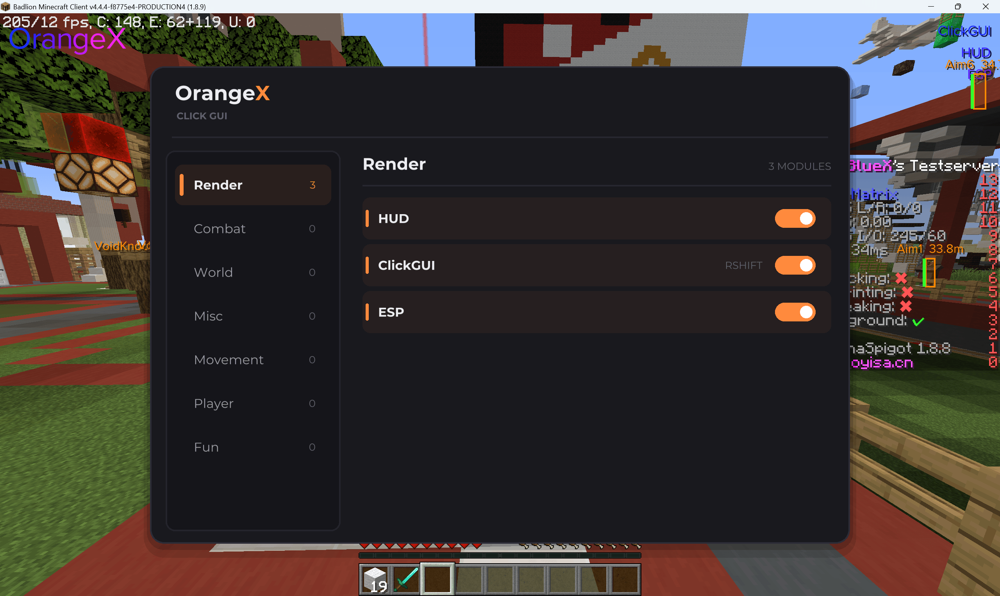
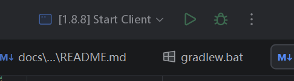

# OrangeX Client



> [!WARNING]
> **项目重构中 / Under Refactoring**
>
> 当前 `main` 分支为重构版本，项目架构、API 和功能仍在持续调整中，暂不保证向后兼容。
>
> The `main` branch contains the rewritten client. Its architecture, APIs, and features are still evolving and may change without notice.
>
> 旧版本请访问：[OrangeX-Client-Legacy](https://github.com/xiaozhou233/OrangeX-Client-Legacy)

## 项目介绍 | Introduction

OrangeX Client 是一个面向 Minecraft 的注入式辅助客户端

OrangeX Client is an injection-based Minecraft utility client

## 支持的版本 | Compatibility

以下表格列出了目前已验证的 Minecraft 版本与运行环境组合。

| Minecraft Version | Vanilla | Forge | Fabric | Badlion Client | Lunar Client | MCP |
|:-----------------:|:-------:|:-----:|:------:|:--------------:|:------------:|:---:|
|       1.8.9       |   ✓    |  ✓   |   —    |       ✓       |      ✓      | ✓  |
|       26.2        |   ✓    |  ✗   |   ✓   |       —        |      —       |  —  |

**状态说明：**

- ✓ Supported：已支持并验证
- ✗ Unsupported：已验证不支持
- — N/A / Untested：环境不存在或尚未完成测试

> 兼容性信息仅反映已经验证的组合，不代表其他未列出的环境一定不兼容。

## 下载 | Downloads

### Stable Releases

正式发布版本可从 GitHub Releases 获取：

[OrangeX Client Releases](https://github.com/xiaozhou233/OrangeX-Client/releases)

### Development Builds

开发版本由 Jenkins 自动构建并发布：

[Jenkins - OrangeX Client](https://jenkins.xiaozhou233.cn/job/OrangeX-Client/)

> [!NOTE]
> 开发版本可能包含未完成的功能、实验性接口或尚未修复的问题，不建议在生产环境中使用。

## 构建 | Building

### 环境要求 | Requirements

| 环境 | 要求 |
|---|---|
| Java | 25 |
| Network | 需要网络连接以下载构建依赖 |
| Build Tool | Gradle Wrapper（项目自带） |

### 开始构建 | Build

克隆项目后，在项目根目录执行：

```bash
./gradlew packageAll
```

Windows 环境：

```bat
gradlew.bat packageAll
```

> [!IMPORTANT]
> `build` 任务被有意禁用。请使用 `packageAll` 进行完整构建。
>
> The `build` task is intentionally disabled. Use `packageAll` instead.

### 构建产物 | Artifacts

构建完成后，产物将输出到 `out/` 目录。

| 路径 | 说明 |
|---|---|
| `out/injection.zip` | 完整注入包，包含 Loader、OrangeX、原生 DLL 和配置文件 |
| `out/injector.jar` | 图形化注入器，内置 FlatLaf |
| `out/tmp/` | 打包过程中生成的临时文件 |

首次构建时，Gradle 会自动下载所需依赖并保存到 `libraries/` 目录。

如果依赖下载失败，请检查网络连接及代理配置。

## 使用指南 | Usage

### 1. 获取程序

选择以下任意一种方式获取 OrangeX Client：

- [GitHub Releases](https://github.com/xiaozhou233/OrangeX-Client/releases)
- [Jenkins Development Builds](https://jenkins.xiaozhou233.cn/job/OrangeX-Client/)
- 自行构建，参见 [构建指南](#构建--building)

### 2. 启动注入器

```bash
java -jar injector.jar
```

### 4. 执行注入

在图形化注入器中选择目标 Minecraft 进程，并按照界面提示完成注入。

## 开发指南 | Development

### 开发环境 | Requirements

| 环境    | 要求                                      |
|---------|-------------------------------------------|
| Java    | 25                                        |
| IDE     | IntelliJ IDEA 2026.2.3 或更高版本（推荐） |
| Git     | 用于版本控制                              |
| Network | 需要网络连接                              |

### 初始化项目 | Setup

**1. 克隆仓库**

```bash
git clone https://github.com/xiaozhou233/OrangeX-Client.git
cd OrangeX-Client
```

**2. 使用 IntelliJ IDEA 打开项目**

等待 Gradle 同步及依赖下载完成。

**3. 准备 Minecraft 开发环境**

加入项目 QQ 群 1103504356，从群文件下载 `Minecraft1.8.8.zip`。

将压缩包解压到`Minecraft1.8.8/`目录，确保目录中有`src/`和`runtime/`

**4. 开始开发**

根据需要修改对应模块的代码。

**5. 运行客户端**

使用 IntelliJ IDEA 中配置好的运行配置启动 Minecraft 客户端。



## 其他 | Others

- 项目仍处于积极重构阶段，部分功能和接口可能发生变化。
- 欢迎提交 Issue 和 Pull Request。
- 使用过程中遇到问题，可以通过项目 Issue 或 QQ 群反馈。